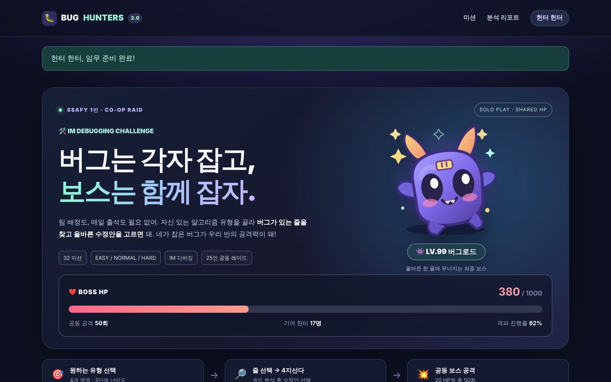
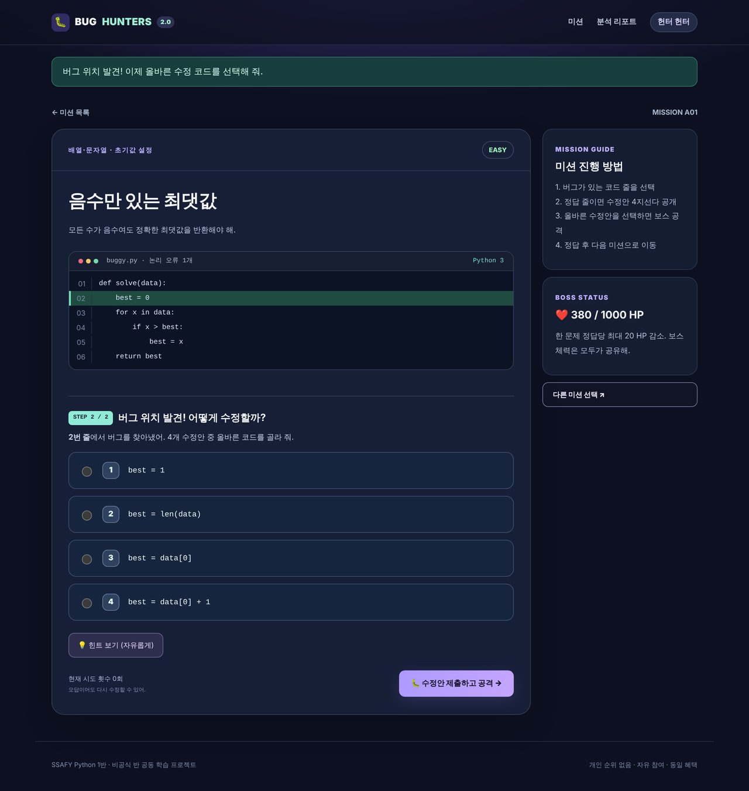
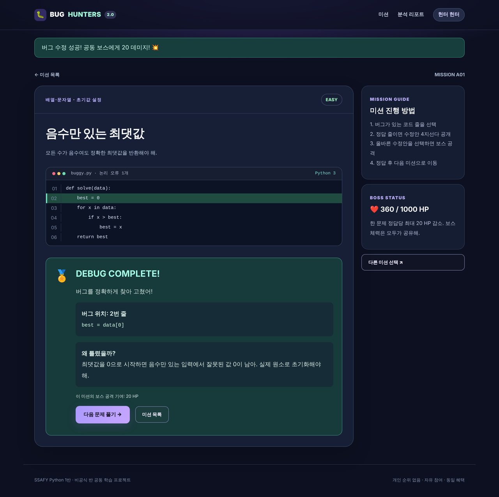
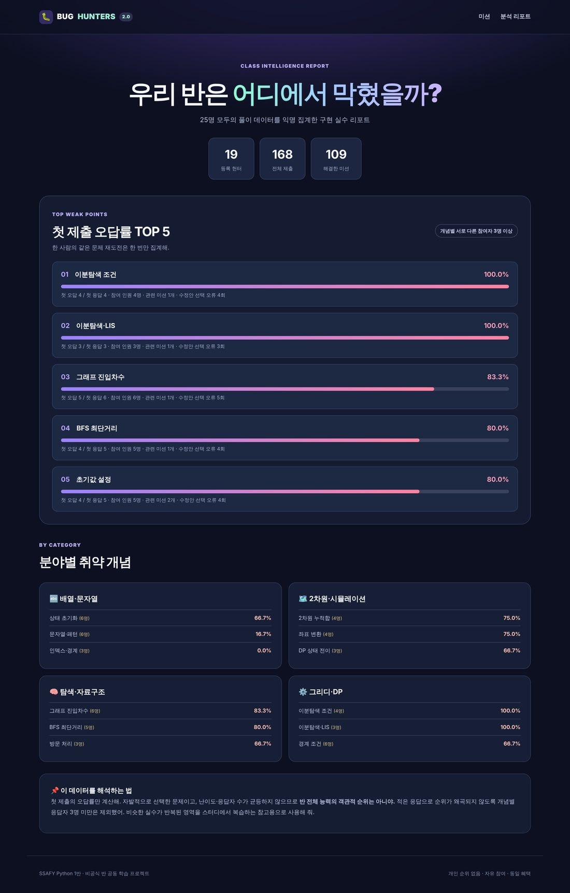
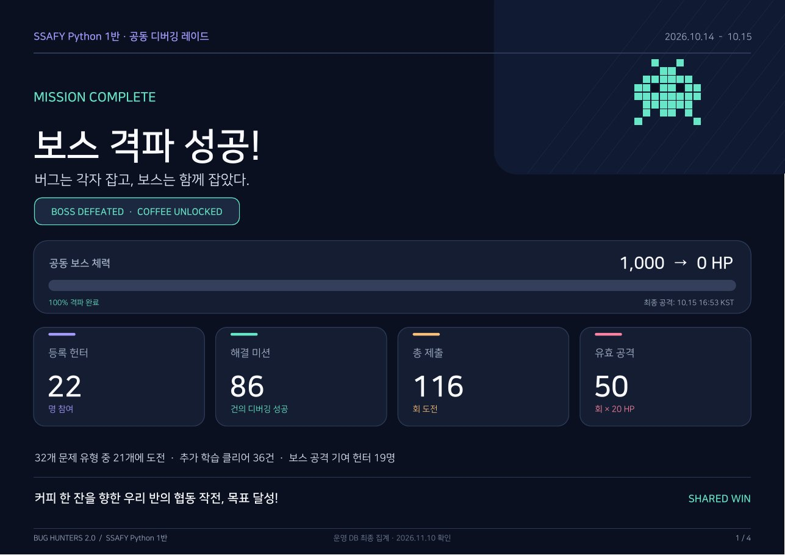
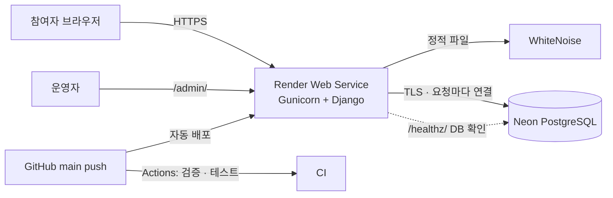
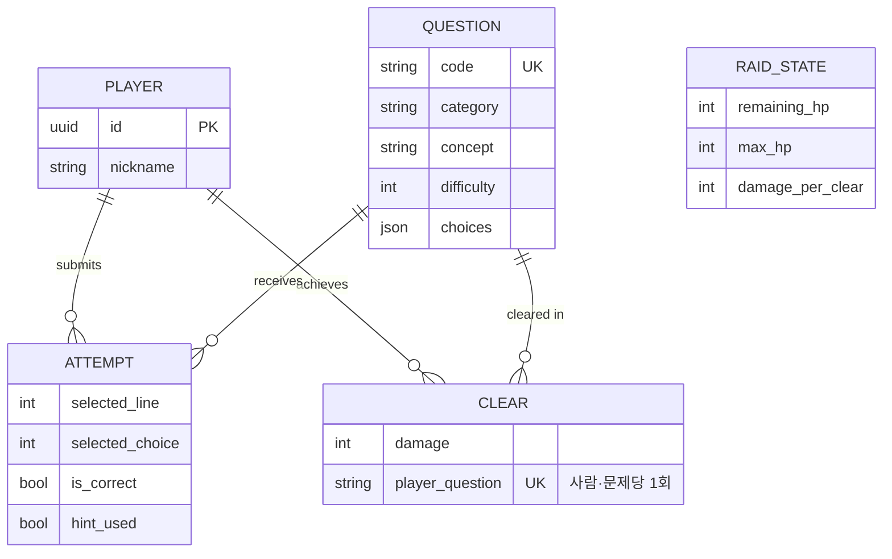

# 🐛 BUG HUNTERS 2.0 — 반 전체가 함께 잡는 디버깅 레이드

> 틀린 코드 속 **버그 한 줄**을 찾아 고치면, 반 전체가 공유하는 보스의 HP가 깎이는 **협동형 알고리즘 학습 웹 서비스**

SSAFY 1반 교육생 25명을 대상으로 기획부터 문제 출제, 개발, 배포, 운영까지 **혼자 진행한 1인 프로젝트**예요.
경쟁 위주의 문제 풀이 대신 "각자 풀고 함께 이기는" 구조를 만들었고, 이벤트가 끝나면 반 전체의 **취약 알고리즘 개념 TOP 5**를 데이터로 보여줘요.



| 기간 | 인원 | 역할 | 운영 결과 |
|---|---|---|---|
| 2026.10 개발 · 배포<br>2026.10.14 – 10.15 운영 | 1인 | 기획 · 문제 출제 · 백엔드 · 프론트엔드 · 배포 · 운영 | 반 25명 중 **22명 참여 (88%)**<br>**116회 제출 · 86건 해결**<br>**이틀 만에 보스 격파** |

<br>

## 📌 목차
1. [기획 배경](#-기획-배경)
2. [주요 기능](#-주요-기능)
3. [운영 결과](#-운영-결과)
4. [기술 스택](#-기술-스택)
5. [아키텍처 · ERD](#-아키텍처--erd)
6. [핵심 문제 해결 경험](#-핵심-문제-해결-경험)
7. [테스트 · CI](#-테스트--ci)
8. [실행 방법](#-실행-방법)
9. [회고](#-회고)

<br>

## 💡 기획 배경

| 문제 | 해결 방향 |
|---|---|
| 알고리즘 문제 풀이는 **새로 짜는 부담**이 커서 참여율이 낮아요 | 이미 짜인 코드에서 **틀린 한 줄만 찾는** 디버깅 미션으로 부담을 낮췄어요 |
| 개인 순위가 생기면 실력 차이 때문에 **참여를 망설이게** 돼요 | 개인 순위를 없애고 **공동 보스 HP**를 모두가 함께 깎는 협동 구조로 만들었어요 |
| 소수가 문제를 몰아서 풀면 "반 전체 이벤트"가 아니게 돼요 | 1인당 보스 공격을 **최대 3회**로 제한해서, 최소 17명이 참여해야 격파되게 설계했어요 |
| 이벤트가 끝나면 **무엇을 복습해야 하는지** 남지 않아요 | 첫 제출 오답률로 반 전체의 **취약 개념 TOP 5** 리포트를 만들었어요 |

- **문제 32개를 직접 만들었어요.** 4개 분야(배열·문자열 / 2차원·시뮬레이션 / 탐색·자료구조 / 그리디·DP)와 3단계 난이도(EASY 6 · NORMAL 12 · HARD 14)로 구성했어요.
- **개인정보는 최소한으로 모아요.** 닉네임과 풀이 기록만 저장하고, 이메일이나 전화번호는 받지 않아요. 기록 저장에 동의해야 참여할 수 있어요.

<br>

## 🎮 포트폴리오 체험 모드

**라이브 데모:** https://ssafy-bug-hunters-2.onrender.com

2026년 10월 행사 종료 후 **읽기 전용 체험 모드**로 전환했어요. 별도 회원가입이나 초대 코드 없이 32개 문제를 풀 수 있고, 단계별 버그 위치 판정 → 4지선다 선택 → 해설 → 다음 문제 흐름을 체험할 수 있어요.

- 실제 행사 보스 HP **0/1,000**과 기존 참가자·풀이·분석 기록은 변경되지 않아요.
- 방문자별 체험 완료 문제와 재시도 횟수는 **브라우저 세션**으로 분리하며, 전체 참가 통계에 포함하지 않아요.
- 체험 진행 상황은 홈 화면의 **내 체험 기록 초기화**로 재설정할 수 있어요.
- 관리자 인증 및 과거 데이터 조회 기능은 그대로 보호돼요.
- 운영 설정: Render 환경변수 `RAID_DEMO_MODE=1` (이벤트 운영 시에는 `0`).

<br>

## ✨ 주요 기능

### 1. 2단계 디버깅 미션
**STEP 1**에서 버그가 있는 줄을 클릭해요. 서버가 맞는 줄인지 확인한 다음에야 **STEP 2**의 수정안 4지선다가 화면에 나타나요.

<p align="center"></p>

### 2. 공동 보스 공격과 해설
정답을 맞히면 공동 보스에게 20 데미지를 주고, 버그 위치와 **왜 틀렸는지** 해설을 보여줘요. 해결하지 않은 다음 문제로 바로 이동할 수 있어요.

<p align="center"></p>

### 3. 취약 개념 분석 리포트
보스가 격파되면 리포트가 공개돼요. 같은 사람이 같은 문제를 다시 시도한 기록은 빼고 **첫 제출**만 집계해요. 응답자가 3명 미만인 개념은 순위에서 제외해서 통계가 왜곡되지 않게 했어요.

<p align="center"></p>

<sub>※ 위 스크린샷은 로컬에서 만든 시연용 데이터로 찍었어요. 실제 운영 결과는 아래에 정리했고, 참여자 개인 데이터는 레포에 포함하지 않았어요.</sub>

### 4. 운영자 기능
- Django Admin에서 참여자별 **제출 기록과 해결 기록**을 읽기 전용으로 조회해요.
- 첫 제출 기준 분석 결과를 CSV로 내려받을 수 있어요(관리자만, POST 요청).
- 관리 명령어: 문제 시딩(`seed_questions`), 초기 관리자 생성(`bootstrap_admin`), 레이드 초기화(`reset_raid --confirm`)

<br>

## 📊 운영 결과

2026년 10월 14일부터 15일까지 실제 반 이벤트로 운영했어요. 아래 수치는 운영 DB 최종 집계이고, 개인정보는 제외했어요.

<p align="center"></p>

| 지표 | 결과 | 의미 |
|---|---|---|
| 참여율 | 반 25명 중 **22명 (88%)** | 강제 참여 없이 자유 참여로 운영했어요 |
| 보스 격파 | 이틀째 **16:53**에 HP 1,000 → 0 | 유효 공격 50회로 설계대로 격파됐어요 |
| 공격 기여 인원 | **19명** | 최소 17명이 공격해야 격파되도록 한 **1인 3회 상한**이 실제로 참여를 분산시켰어요 |
| 추가 학습 | 해결 86건 중 **36건 (42%)** | 공격 상한을 다 쓴 뒤에도 데미지 없이 계속 문제를 풀었어요 |
| 첫 제출 정답률 | **76.7%** (66/86) | EASY 83.0% → NORMAL 75.0% → HARD 53.8%로, 출제 난이도가 실제 체감 난이도와 맞았어요 |
| 재시도 | 첫 제출 오답 20건 **모두 재시도 후 해결** | 오답이어도 다시 도전할 수 있게 한 설계가 끝까지 풀게 만들었어요 |

**데이터로 발견한 한계**
- 해결 86건 중 **60건(70%)이 배열·문자열** 분야였고, 문제 32개 중 **11개는 아무도 도전하지 않았어요.** "다음 문제" 버튼이 난이도 → 문제 코드 순으로 추천해서 같은 난이도 안에서는 배열 문제(A01~)가 항상 먼저 나온 것이 원인 중 하나로 보여요.
- 1단계(버그 줄 찾기)에서 틀린 횟수는 기록하지 않아서, **"줄을 못 찾은 건지, 고치는 법을 몰랐던 건지"를 구분할 수 없었어요.** 분석에 필요한 데이터를 설계 단계에서 미리 정하지 않은 아쉬움이 남았어요.

<br>

## 🛠 기술 스택

| 구분 | 기술 |
|---|---|
| Backend | Python 3.12, Django 5.2 |
| Database | PostgreSQL (Neon, 운영) · SQLite (로컬) |
| Frontend | Django Template, Vanilla JS, CSS |
| Infra | Render (Gunicorn + WhiteNoise), Neon Serverless PostgreSQL |
| CI | GitHub Actions (문제은행 검증 → Django check → 테스트) |

<br>

## 🏗 아키텍처 · ERD





- `Attempt`에는 모든 제출을 남기고(통계용), `Clear`에는 **사람·문제당 한 번만** 남겨요(데미지용). 두 모델로 나눠서 "학습 기록"과 "보스 공격"을 분리했어요.
- `RaidState`는 반 전체가 공유하는 단일 행이고, 모든 공격이 이 행을 갱신해요.

<br>

## 🔥 핵심 문제 해결 경험

### 1. 여러 명이 동시에 공격할 때 보스 HP가 꼬이는 문제
- **문제:** 여러 사람이 같은 순간에 정답을 내면 각 요청이 같은 HP를 읽고 각자 빼서 저장해요. 그러면 데미지가 사라지는 **Lost Update**가 생길 수 있어요. 같은 사람이 버튼을 두 번 눌러 중복 데미지가 들어갈 위험도 있었어요.
- **해결:**
  - `transaction.atomic()` 안에서 `select_for_update()`로 `RaidState` 행에 **비관적 락**을 걸고, 락을 잡은 뒤에 "이미 해결했는지"를 **다시 확인**해요.
  - DB에 `UniqueConstraint(player, question)`를 걸어서, 애플리케이션 검사를 통과하더라도 중복 해결 기록은 DB가 막아요.
  - 1인당 공격 상한(3회)과 남은 HP보다 큰 데미지가 들어가지 않는 조건도 같은 트랜잭션 안에서 계산해요.
- **검증:** 서로 다른 두 사용자가 같은 보스 HP를 공유하는지, 중복 데미지와 개인 상한이 지켜지는지를 테스트로 확인했어요.

### 2. 사용자 코드를 실행하지 않고 채점하기
- **문제:** 처음에는 "수정 코드 한 줄을 직접 입력"하는 방식이었어요. 하지만 서버에서 사용자가 입력한 Python을 `eval`/`exec`하는 건 원격 코드 실행 위험이 있어서 할 수 없었어요.
- **1차 해결:** Python `tokenize`로 입력을 토큰 단위로 쪼개 정답과 비교했어요. 공백 차이는 무시할 수 있었지만, `a+=1`과 `a=a+1`처럼 **결과는 같은데 표현이 다른 답**을 오답으로 처리하는 한계가 남았어요.
- **최종 해결:** "버그 줄 찾기 → 4지선다 수정안 선택" 2단계 방식으로 바꿨어요. 서버는 **선택지 번호만** 받아서 채점해요. 직접 출제한 오답 보기 3개는 검증 스크립트(`scripts/validate_bank.py`)로 **실제로 다른 결과를 내는지** 확인했어요.

### 3. 클라이언트 우회와 정답 노출 막기
- **문제:** 4지선다로 바꾸면서, 1단계(줄 찾기)를 건너뛰고 POST 요청을 직접 만들어 보내면 바로 정답을 제출할 수 있는 구멍이 생겼어요. HTML 소스에 보기나 정답이 미리 들어 있어도 안 되고요.
- **해결:**
  - 줄을 맞혔는지는 **서버 세션**에 저장하고, 제출할 때 서버가 다시 확인해요. 클라이언트가 보낸 줄 번호는 믿지 않아요.
  - 줄을 맞히기 전에는 보기 4개를 **아예 HTML로 렌더링하지 않아요.** 정답과 해설은 해결한 뒤에만 보여줘요.
  - 상태 API(`/api/status/`)에는 HP 정보만 담고, 문제은행 원본 JSON은 프론트에 내려보내지 않아요.
- **검증:** 위조된 POST, 범위를 벗어난 보기 번호, 줄 검증 없이 바로 제출하기, 해결 전 정답 노출 같은 경우를 **각각 테스트로** 막았어요.

### 4. 무료 인프라에서 안정적으로 운영하기
- **문제:** Render 무료 PostgreSQL은 **30일이 지나면 만료**돼서 행사 데이터를 잃을 수 있었어요. 대안으로 고른 Neon은 서버리스라 쉬는 동안 연결이 끊겨요.
- **해결:**
  - DB는 외부 Neon으로 분리했어요. `conn_max_age=0`과 `conn_health_checks`로 끊긴 연결을 재사용하지 않게 했고, 운영 환경에서는 TLS를 강제해요.
  - `/healthz/`는 앱이 살아 있는지만 보지 않고 **실제로 DB 쿼리를 날려** 확인해요. 실패하면 503을 돌려줘요.
  - 운영 환경에서 시크릿 키(40자 이상), `DATABASE_URL`, 참여 코드가 없으면 **서버가 아예 뜨지 않게** 했어요(fail-fast).
  - 무료 플랜이라 셸을 쓸 수 없어서, 환경변수로 **딱 한 번만** 관리자를 만드는 `bootstrap_admin` 명령을 만들었어요. 비밀번호는 출력하지 않고, 이미 있는 계정은 건드리지 않아요.

### 5. CI에서만 테스트가 실패하던 문제
- **문제:** 로컬에서는 통과하는데 CI에서는 `Missing staticfiles manifest entry` 오류로 테스트가 실패했어요.
- **원인:** 운영용 `CompressedManifestStaticFilesStorage`는 `collectstatic`으로 만든 manifest 파일이 있어야 템플릿을 렌더링할 수 있는데, CI에는 이 단계가 없었어요.
- **해결:** CI 파이프라인을 운영 배포와 같은 순서로 맞췄어요. `validate_bank → check → migrate → seed → collectstatic → test` 순서예요.

<br>

## ✅ 테스트 · CI

푸시와 PR마다 GitHub Actions가 아래를 자동으로 검증해요.

1. **문제은행 검증** (`scripts/validate_bank.py`): 직접 출제한 문제 32개 × 입력 3개마다 버그 코드는 반례 1개에서만 틀리는지, 4개 보기 중 정답은 하나뿐인지, 오답 보기 3개가 실제로 틀리는지 확인해요.
2. **Django 테스트 22개** (`raid/tests/test_raid.py`)

| 분류 | 검증 내용 |
|---|---|
| 동시성 · 게임 규칙 | 여러 사용자의 HP 공유, 최초 해결 시에만 데미지, 1인 공격 상한 |
| 보안 · 우회 방지 | 줄 검증 없이 직접 POST, 위조된 수정안, 범위 밖 보기 번호, 비로그인 제출, 참여 코드 |
| 정답 노출 방지 | 해결 전 정답 미노출, API에 정답 정보 없음, 격파 전 리포트 잠금 |
| 통계 | 첫 제출만 집계 |
| 운영 | 헬스체크, 동의 필수, 관리자 화면 |

<br>

## 🚀 실행 방법

```bash
python -m venv .venv && source .venv/bin/activate   # Windows: .venv\Scripts\activate
pip install -r requirements.txt
python manage.py migrate
python manage.py seed_questions
python manage.py runserver        # http://127.0.0.1:8000
```

```bash
# 테스트 (운영 설정과 같게 정적 파일을 먼저 수집해요)
python scripts/validate_bank.py
python manage.py collectstatic --noinput && python manage.py test
```

배포와 운영 가이드는 [`docs/OPERATIONS.md`](docs/OPERATIONS.md)에 정리해 두었어요.

<details>
<summary><b>📁 프로젝트 구조</b></summary>

```
├── raid/
│   ├── models.py          # Player · Question · Attempt · Clear · RaidState
│   ├── views.py           # 참여, 2단계 검증, 트랜잭션 기반 공격, 리포트, CSV
│   ├── logic.py           # 정답 줄 계산, 토큰 기반 수정안 비교 (코드 실행 없음)
│   ├── stats.py           # 첫 제출 기준, 최소 표본 조건을 둔 취약 개념 통계
│   ├── admin.py           # 참여자별 읽기 전용 기록 조회
│   ├── question_bank.json # 직접 출제한 문제 32개
│   ├── management/commands/  # seed_questions · bootstrap_admin · reset_raid
│   └── tests/test_raid.py
├── raidsite/settings.py   # 환경변수 기반 설정, 운영 환경 fail-fast 검증
├── scripts/validate_bank.py
├── render.yaml · build.sh · start.sh
└── .github/workflows/django-tests.yml
```
</details>

<br>

## 📝 회고

- **기술보다 사용자 먼저:** "어떻게 하면 25명이 부담 없이 참여할까"에서 출발했어요. 개인 순위를 없애고 1인 공격 횟수를 제한했더니, 실제로 22명이 참여하고 19명이 공격에 기여했어요. 기술 결정만큼 **규칙 설계가 참여율에 큰 영향을 준다**는 걸 데이터로 확인했어요.
- **안전한 쪽으로 방향 바꾸기:** 직접 입력 방식이 더 재미있었지만 보안과 채점 정확도 때문에 4지선다로 바꿨어요. 기능을 포기한 대신, 정답 줄 찾기 단계를 추가해 학습 효과는 지켰어요.
- **"돌아간다"와 "믿을 수 있다"의 차이:** 동시성, 우회 요청, 정답 노출처럼 정상 사용에서는 드러나지 않는 문제를 테스트로 먼저 정의하고 막는 습관을 들였어요.
- **다음에 개선하고 싶은 점**
  - **분야 쏠림 줄이기:** 풀이가 배열·문자열에 70% 몰렸어요. 다음에는 분야별 보너스 데미지나 "아직 아무도 안 푼 문제" 추천으로 BFS·DP·그리디 도전을 유도하고 싶어요.
  - **분석용 로그 먼저 설계하기:** 1단계 실패 기록이 없어서 막힌 지점을 정확히 분석하지 못했어요. 기능을 만들기 전에 "끝나고 무엇을 알고 싶은지"부터 정하고 이벤트 로그를 설계할 거예요.
  - **기록 연속성:** 닉네임 기반 세션이라 브라우저를 바꾸면 기록이 이어지지 않아요. 가벼운 인증 방식과 실시간 HP 반영(SSE)도 넣어보고 싶어요.
